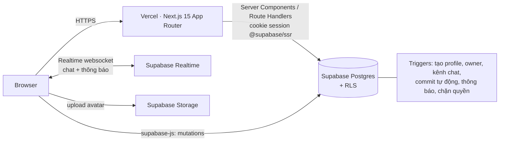

# BecauseManAge — Pitch Kit

> **Because man age.** Con người rồi sẽ già đi, nên làm gì làm cho tử tế.
> **Because manage.** Và muốn làm tử tế thì phải quản lý được.

Tài liệu để trình bày trước team, judges, nhà đầu tư, người ngoài. Có: one-liner, vấn đề, giải pháp, MVP, tính năng nổi bật, kịch bản demo 5 phút, kiến trúc, roadmap, câu hỏi hay bị hỏi.

---

## 1. One-liner

**BecauseManAge là app quản lý công việc tối giản đen trắng: note những thứ cần nhớ bằng mindmap kéo thả, rồi biến chúng thành dự án có milestones theo phase, phân quyền rõ ràng và tiến độ ai cũng nhìn thấy.**

Tagline phụ (chọn theo khán giả):

- *“Manage cho tử tế.”*
- *“Ghi lại thứ cần nhớ, làm xong thứ cần làm.”*
- *“Ít màu mè, nhiều việc xong.”*

## 2. Vấn đề

1. **Note và việc nằm hai nơi.** Thông tin vụn (quán ăn quận 1, 2, 3; tính cách một người cần lưu ý; ý tưởng) nằm ở Notes/Zalo/giấy, còn việc nằm ở Trello/Excel. Khi cần đưa thông tin vào dự án thì phải copy tay.
2. **% tiến độ “nói dối” khi dự án lớn lên.** Đang 100% mà phát sinh thêm việc → hoặc sửa tay, hoặc mất lịch sử “dự án đã lớn lên thế nào”.
3. **Giao việc mập mờ.** Nhiều manager cùng giao, không ai biết ai giao gì cho ai → đến lúc có chuyện không có căn cứ để xử lý công bằng.
4. **Chat lẫn lộn cấp bậc.** Member ngại nói thật trong group có sếp; chuyện quản lý lại bị lọt ra group chung.
5. **Ưu tiên là chuyện cá nhân.** Mỗi người có cách sắp xếp riêng, nhưng tool thường bắt cả team dùng chung một priority.
6. Đa số tool quá nhiều màu, quá nhiều nút → mệt.

## 3. Giải pháp — 4 trụ cột

| Trụ cột | Làm gì |
|---|---|
| **Notes mindmap** | Mặt giấy vô hạn, kéo thả khối, đổi font / nền / cỡ chữ / đậm / nghiêng, nối dây. Có template (quán ăn theo quận, hồ sơ một người, brainstorm). **Một nút “Đưa vào dự án”** để trích khối sang dự án. |
| **Milestones theo phase** | Tiến độ = mốc xong / tổng mốc. **Mở rộng dự án** → % tự co lại (10/10 = 100% → thêm 1 mốc = 91%). Mỗi phase một sắc xanh đậm dần → nhìn thanh tiến độ là thấy lịch sử dự án. |
| **Phân quyền & minh bạch** | Owner → Managers → Members. Bảng phân công tổng ghi rõ *ai giao, cho ai, lúc nào*. Member bấm ⚑ báo vấn đề → Manager khác vào xem xét. Commit log cho mọi thay đổi. |
| **Giao tiếp đúng tầng** | 4 kênh chat: toàn dự án · chỉ Members · tuỳ chọn · ban quản lý. Note bàn giao có “đã xem bởi”. Priority cá nhân 🔒 chỉ mình thấy. |

## 4. MVP — phạm vi đã làm

✅ = có trong bản này

**Tài khoản & profile**
- ✅ Đăng ký / đăng nhập email (Supabase Auth), xác nhận email, đăng xuất
- ✅ Profile: bio, field (Engineering, Business, Education, …), avatar (PNG/JPG/WEBP/GIF ≤ 2MB), status, thông tin cá nhân tuỳ chọn, links
- ✅ Cá nhân hoá: banner (5 kiểu giấy), font tên (4 kiểu), đảo màu banner
- ✅ Followers / Following, số dự án đang & đã tham gia, pin tối đa 6 dự án nổi bật
- ✅ Biểu đồ commit 1 năm kiểu GitHub — **đen trắng**
- ✅ Threads: post / article / chia sẻ link, tag, trả lời kiểu imageboard (No., `>>` trích dẫn), bump

**Notes mindmap**
- ✅ Kéo thả, zoom, pan, nối dây, tạo khối con, chọn nhiều, nhân bản, autosave
- ✅ Font (sans / serif / mono / viết tay), cỡ chữ, nền, màu chữ, đậm / nghiêng / gạch chân (cả khối hoặc từng chữ), căn lề, kiểu viền
- ✅ 4 template, trích xuất khối đã chọn hoặc cả bảng sang dự án

**Dự án**
- ✅ Labels 3 tầng cố định thứ tự: 🟨 ngành nghề · 🟦 label tự gắn · ⬛ nhu cầu (Công việc, Gia đình, Chi tiêu…)
- ✅ Milestones theo phase, mở rộng dự án, thanh tiến độ màu phase
- ✅ Mark nhiều mốc một lúc: *In progress / Completed / Hiatus — Marked by X; Y*
- ✅ Owner bổ nhiệm Manager; Owner/Manager giao việc → Member nhận thông báo
- ✅ Bảng phân công tổng + tổng hợp theo thành viên + báo vấn đề + xem xét lại
- ✅ Gantt (ngày / tuần, phase màu, hôm nay, hạn dự án)
- ✅ Lịch ngày / tuần / tháng: hạn milestone, hạn task, sự kiện
- ✅ Priority cá nhân Low / Moderate / High — người khác không thấy (chặn ở DB)
- ✅ Chat realtime 4 tầng
- ✅ Notes bàn giao + note trích từ mindmap, “đã xem bởi”
- ✅ Commits: tự sinh khi mark mốc / đổi trạng thái task / viết note + `git commit -m` thủ công

**Nền tảng**
- ✅ Row Level Security cho mọi bảng → quyền được kiểm ở database, không chỉ ẩn nút ở UI
- ✅ Thông báo trong app (realtime)
- ✅ Responsive mobile

## 5. Tính năng “wow” để nhấn khi demo

1. **Thanh tiến độ biết kể chuyện** — dự án 100% → bấm *Mở rộng dự án* thêm 5 mốc → còn 67%, xuất hiện một khúc xanh đậm hơn. Lịch sử dự án hiện ngay trên một thanh.
2. **Từ note đến việc trong 2 click** — chọn 3 khối trong mindmap “Quán ăn Q1–Q3” → *Đưa vào dự án* → team thấy nguyên khối, giữ đúng màu / font.
3. **“Marked by X; Y”** — hai người cùng mark một mốc, ai cũng thấy ai đang làm gì.
4. **Công minh khi có chuyện** — Member bấm ⚑, Manager thứ 2 mở bảng phân công thấy rõ Manager 1 giao gì, lúc nào, rồi giao lại.
5. **Kênh Members không có sếp** — đổi qua tài khoản Owner thì kênh đó bị khoá 🔒.
6. **Priority 🔒** — hai người cùng nhìn một task, mỗi người thấy priority của riêng mình.
7. **Profile có biểu đồ commit đen trắng** — “GitHub cho người không code”.

## 6. Kịch bản demo 5 phút

Chuẩn bị trước: 3 tài khoản (An = Owner, Bình = Manager, Chi = Member), 1 dự án *“Ra mắt quán cà phê”* đã có Phase 1 (5 mốc, xong 4), vài task, vài tin chat. Mở 2 trình duyệt cạnh nhau.

| Phút | Màn hình | Nói gì |
|---|---|---|
| 0:00 | Landing | “Because man age — con người rồi sẽ già, nên làm gì làm cho tử tế. Và vì cần manage.” Nêu 2 vấn đề: note với việc nằm hai nơi; % tiến độ nói dối khi dự án lớn lên. |
| 0:40 | Notes → template *Quán ăn theo quận* | Kéo khối, đổi nền vàng, in đậm một dòng, nối dây. Chọn 2 khối → **Đưa vào dự án**. |
| 1:30 | Dự án → tab Notes | Khối vừa trích hiện y nguyên. Chi mở → “Đã xem bởi: Chi”. |
| 2:00 | Tab Milestones | Chi tick mốc cuối → *Completed*. Thanh lên 100%. An bấm **Mở rộng dự án** thêm 3 mốc → còn 63%, phase 2 xanh đậm hơn. |
| 2:50 | Tab Phân công (Bình) | Bình giao việc cho Chi → bên Chi chuông có thông báo. Chi bấm ⚑ “trùng việc”. An mở *Xem xét* → giao lại. Chỉ vào bảng: ai giao, lúc nào. |
| 3:40 | Gantt → Lịch | Phase màu trên Gantt, đường đỏ hôm nay. Lịch tháng có hạn mốc + sự kiện. |
| 4:10 | Chat | Chi thấy kênh *members*; An thì bị khoá. Gõ một tin, bên kia nhận realtime. |
| 4:30 | Profile Chi | Biểu đồ commit đen trắng, dự án đã pin, threads. |
| 4:50 | Chốt | “Ít màu, nhiều việc xong. Manage cho tử tế.” |

**Backup nếu mạng chậm:** quay sẵn video 60 giây cho đoạn 2:00–3:40.

## 7. Kiến trúc



- **Đọc**: Server Components gọi Supabase bằng session trong cookie → HTML render sẵn, nhanh và tốt cho SEO.
- **Ghi**: Client gọi thẳng Supabase (nhờ RLS nên an toàn) → `router.refresh()` để cập nhật.
- **Quy tắc nghiệp vụ nằm trong database**: trigger tự ghi *ai giao việc*, chặn Member sửa task của người khác, chỉ Owner được bổ nhiệm Manager, tự sinh commit và thông báo. Đổi frontend (mobile app chẳng hạn) thì luật vẫn giữ nguyên.

Mô hình dữ liệu chính:

```
profiles ─┬─ follows
          ├─ mindmaps (JSON: nodes, edges)
          ├─ posts ── post_replies
          └─ project_members ── projects ─┬─ project_labels
                                          ├─ milestones ── milestone_marks
                                          ├─ tasks
                                          ├─ personal_priorities (riêng tư)
                                          ├─ project_events
                                          ├─ member_notes ── note_reads
                                          ├─ commits
                                          └─ chat_channels ── chat_messages
```

## 8. Vì sao chọn tech stack này

| Lựa chọn | Lý do |
|---|---|
| Next.js 15 App Router + TypeScript | Server Components + Route Handlers trong 1 repo, deploy 1 click trên Vercel. |
| Tailwind CSS v4 | Design tokens ngay trong CSS, style vẽ tay chỉ cần vài class dùng chung. |
| Supabase | Postgres thật + Auth + Storage + Realtime, RLS cho phân quyền phức tạp mà không cần viết backend riêng. Free tier đủ cho MVP. |
| Tự viết Gantt / Lịch / Mindmap | Không phụ thuộc thư viện nặng, giữ đúng phong cách đen trắng, bundle nhẹ. |

## 9. Ai dùng?

- **Nhóm sinh viên / hackathon**: phân việc rõ ràng, có bằng chứng ai làm gì (commits).
- **Team nhỏ 3–15 người** (agency, startup, CLB, NGO): đủ quyền hạn mà không nặng như Jira.
- **Cá nhân**: note đời sống (quán ăn, người quen, chi tiêu, gia đình) + dự án cá nhân với label *Gia đình / Chi tiêu*.

## 10. Roadmap

| Giai đoạn | Nội dung |
|---|---|
| **v0.2** | Kéo thả sắp xếp milestone; sửa ngày trực tiếp trên Gantt; mention `@user` trong chat/note; email digest hằng tuần. |
| **v0.3** | Mindmap nhiều người sửa cùng lúc (Supabase Realtime / CRDT); chia sẻ bảng note read-only. |
| **v0.4** | Template dự án (sự kiện, ra mắt sản phẩm, đồ án); export PDF báo cáo tiến độ; PWA + push notification. |
| **v1.0** | Workspace / tổ chức, gói trả phí cho team (lưu trữ, lịch sử không giới hạn), tích hợp Google Calendar. |

Mô hình doanh thu (gợi ý): Free cho cá nhân và team ≤ 5 người → **Team** theo đầu người/tháng (không giới hạn dự án, lịch sử commit, export) → **Edu** giảm giá cho trường/CLB.

## 11. Chỉ số để đo

- % dự án có ≥ 1 lần *Mở rộng dự án* (tính năng phase có được dùng không)
- Số khối note được trích sang dự án / tuần (cầu nối note → việc)
- Thời gian từ lúc giao việc → Member mark *In progress*
- Số task bị ⚑ và thời gian xử lý
- Retention tuần 4 của team ≥ 3 người

## 12. Câu hỏi hay bị hỏi

**Khác gì Trello / Notion / Jira?**
Trello thì không có phân quyền giao việc và không có lịch sử “ai giao”; Notion mạnh về note nhưng yếu phần quyền hạn & tiến độ; Jira quá nặng với team nhỏ. BecauseManAge nối **note tự do (mindmap)** với **dự án có quyền hạn rõ ràng**, và có **tiến độ theo phase** — thứ cả ba đều không có.

**Mark Completed mà người khác chưa đồng ý thì sao?**
Bản MVP: chỉ cần 1 người mark Completed là mốc tính xong, và ai đã mark đều hiện tên nên vẫn minh bạch. Luật này nằm gọn trong 1 hàm (`milestoneState`), đổi sang “cần Manager xác nhận” hoặc “cần đa số” rất nhanh.

**Bảo mật thế nào?**
Mọi bảng bật Row Level Security. Priority cá nhân, kênh Members, kênh quản lý đều chặn ở tầng database — gọi API trực tiếp cũng không đọc được. Member không sửa được task của người khác (trigger chặn). HTML trong note được lọc bằng DOMPurify.

**Scale được không?**
Postgres + index trên các cột truy vấn chính, realtime chỉ subscribe theo từng kênh. Với vài nghìn user thì free/pro tier Supabase là đủ; khi lớn hơn thì tách đọc nặng (Gantt, thống kê) sang view/materialized view.

**Vì sao đen trắng?**
Màu chỉ dành cho thứ cần chú ý: labels (vàng / xanh sky / đen) và tiến độ (các sắc xanh lá theo phase). Còn lại là giấy và mực, để mắt tập trung vào việc.

---

### Slide outline (nếu cần làm deck 8 slide)

1. **Title** — BecauseManAge · *because man age / because manage*
2. **Problem** — note ≠ việc; % tiến độ nói dối; giao việc mập mờ
3. **Solution** — 4 trụ cột
4. **Demo** — (live)
5. **Wow features** — thanh tiến độ phase, marked by X; Y, ⚑ công minh, chat 4 tầng, priority 🔒
6. **Tech & Security** — sơ đồ kiến trúc + RLS
7. **Users & Roadmap**
8. **Ask / Team** — cần gì từ judges/nhà đầu tư
